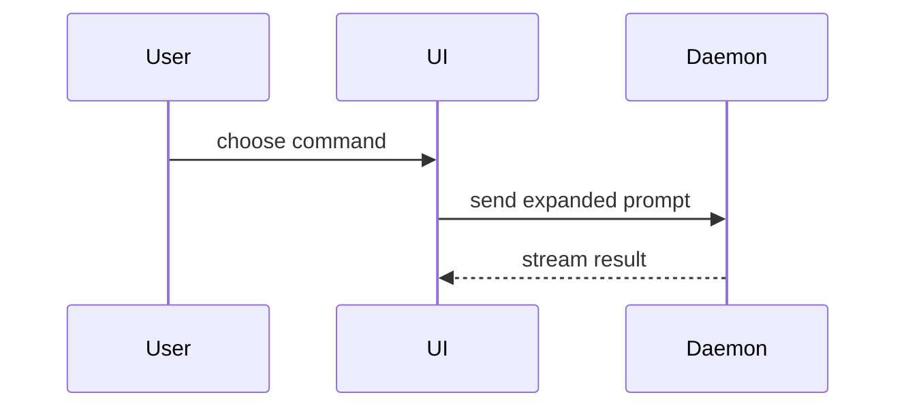

This repo reviews through **Gerrit**. There is no pull request, so there is no PR body: the Change description *is* the commit message, and it must match `docs/agents/git.md` field for field.

## 1. Commit message (the Change description)

Read `docs/agents/git.md` and fill its field format exactly - one field per line, `[Reference  ]` always `体验走查`. Never invent the format, never invent `Version`, never hand-write the `Change-Id`: the `commit-msg` hook writes it.

Keep each field short. Detail that does not fit belongs in the review note below.

## 2. Review note (optional, posted as a Change comment)

Post it after the push with `git push origin HEAD:refs/for/<branch>`, so reviewers meet the note next to the diff.

### Summary

Pick the smallest view that makes the key point clear. Use the user's domain language.

- Show logic or an algorithm as pseudocode:

```text
on(save)
  if content is unchanged
    return cached result
  write new content
  return fresh result
```

- Show runtime control flow as a call tree:

```text
submitForm
  createSession
    persistPrompt
    launchAgent
  navigateToSession
```

- Show UI structure as a component tree, including state and module boundaries that matter:

```text
<SessionPage> (apps/example/src/routes/session.tsx)
  useSessionEvents()
  <SessionToolbar>
    <RunSkillButton> (packages/ui)
```

- Show file responsibility or a broad refactor as a shallow file tree:

```text
src/
├── commands/       # parses user actions
├── sessions/       # owns session state
└── transport/      # sends API requests
```

- Show component interaction, control flow, or data flow with Mermaid:



- Use `diff` when the point is what changes and the surrounding shape already exists. Match the diff shape to the topic.

For a component change:

```diff
 <SessionPage>
   useSessionEvents()
   <SessionToolbar>
+    <RunSkillButton />
   <SessionTimeline>
+    <SkillResultCard />
```

For a file-layout change:

```diff
 src/
 ├── commands/
+│   └── show-me.ts       # expands the slash command
 ├── sessions/
-└── transport.ts
+└── transport/
+    ├── client.ts
+    └── stream.ts
```

For a call-tree or call-stack change:

```diff
 submitForm
   createSession
     persistPrompt
+    expandSkillMention
     launchAgent
-  navigateToSession
+  navigateToSession
+    subscribeToEvents
```

For a state or control-flow change:

```diff
 on(save)
-  write content
+  if content is unchanged
+    return cached result
+  write new content
+  invalidate cache
```

- Show the whole block when most of it is new, when omitted context would hide ownership or order, or when the user needs a copyable target shape:

```ts
function expandSkill(command: string): string {
  const skillName = command.slice(1);
  return `use the ${skillName} skill`;
}
```

#### Guidance

Place each visual next to the short text it supports. Keep only the calls, files, props, states, and boundaries needed to answer the current question or the discussion point. You may use one of these, several, or none. Don't overwhelm the reviewer.

### Evidence

Concrete evidence that the change works, shown before and after.

Screenshots are S-tier - when the environment is set up for it and the change is visual.

Execution-based evidence is A-tier. Test results, console output. Show the exact test that now fails and passes.

### Merge Danger

Describe whether it is a one-way or two-way door. You can walk back through two-way doors, but not one-way doors. A change that is cheap to revert is lower risk; destructive actions and hard-to-reverse decisions are one-way doors.

The blast radius is the potential impact or scope of the change. Consider all possibilities - layout shift, breakages for consumers, mobile responsiveness, and so on.

## Boundaries

- No `gh pr create`, no PR template, no labels. Review is a Gerrit Change on `refs/for/<branch>`.
- Do not push unless the user asks.
